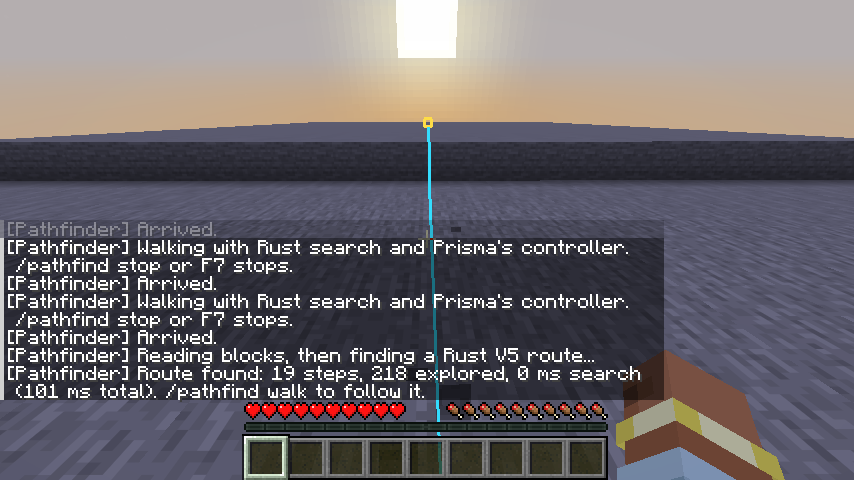

# November 15, 2026 — Java walking search port

The standalone mod now uses a Rust port of my Java pathfinder mod's V5 search and a copy
of its Java movement controller. The old standalone mod only displayed routes.
The agreed scope is walking, jumping, drops and route display.

## Verified

- The release mod builds for Minecraft 26.1.2 and macOS ARM64.
- 307 differential cases match the Java search exactly: route, chosen start,
  explored count, path annotations and signature.
- The native interface rejects malformed buffers and requests.
- Real-client tests passed in a new temporary Minecraft world: flat walking,
  a wall detour, one-block ascent, walking back down, bottom slabs, stairs,
  six snow layers and a three-block drop.
- Route preview returns a visible route. Cancelling a pending walk leaves neither
  forward nor jump held. The client closes cleanly after the suite.

The tests run through the Java/Rust bridge and real Minecraft movement, rather
than assuming a successful build means the player can follow a route.

## Deliberate scope and remaining differences

Rust calculates routes; Java still performs Minecraft movement and rendering.
Mining, teleport recovery and recorded movements are disabled. Searches retain a
bounded loaded-world snapshot and a time/node budget; this differs from the Java mod's
live world reader. A complete speed comparison has not been performed.

## Next

Try the mod in the environments used for the project video, then expand snapshot
coverage and compare end-to-end timings against Java on identical terrain.
Explain the Rust/Java division, what works and these limits in the final video.

Reproduce with `./gradlew build` and `./gradlew runClientGameTest`.
